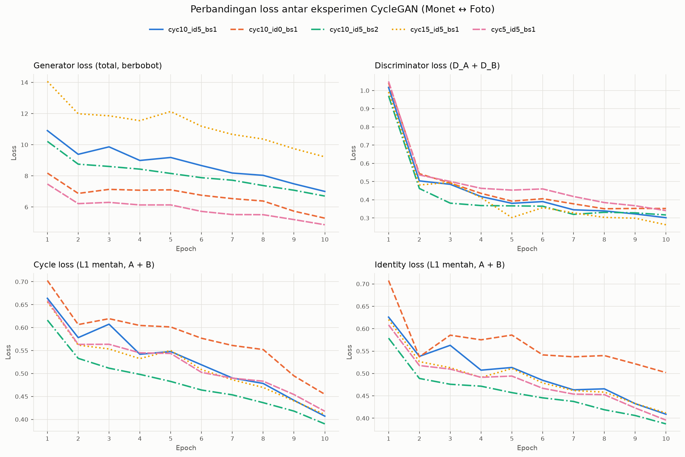
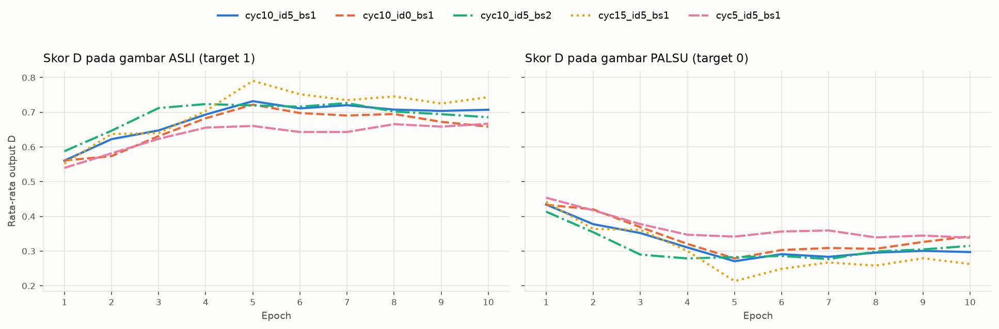
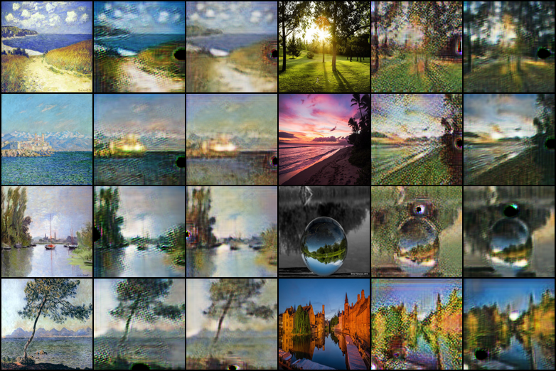

# Laporan Akhir: CycleGAN untuk Translasi Gaya Monet ↔ Foto

**Kelompok:** Kelompok 4
**Mata kuliah:** [ISI NAMA MATA KULIAH]
**Anggota:** Vanza, Raihan, Zara, Dafa
**Repositori:** https://github.com/Revanzavz/CycleGAN

> **Catatan penomoran:** di dokumen ini, titik dipakai sebagai pemisah desimal untuk nilai metrik (mis. 0.2088), mengikuti format tabel hasil eksperimen. Titik juga dipakai sebagai pemisah ribuan untuk jumlah gambar dan parameter (mis. 1.072 gambar).

---

## 1. Pendahuluan

### 1.1 Tujuan proyek

Proyek ini membangun model **CycleGAN dari nol (from scratch) dengan PyTorch** untuk menerjemahkan gaya gambar dua arah: dari lukisan Claude Monet ke foto pemandangan, dan sebaliknya. Model dilatih pada dataset **monet2photo** dengan resolusi **128×128** di laptop dengan GPU **NVIDIA GeForce RTX 3050 Laptop 4 GB**. Karena VRAM terbatas, setiap keputusan desain harus hemat memori.

Seluruh kode dikembangkan dengan bantuan LLM (*vibe coding*). Setiap interaksi didokumentasikan di `LOG_INTERAKSI.md`.

### 1.2 Alasan memilih CycleGAN

- **Data tidak berpasangan.** Untuk setiap lukisan Monet tidak ada foto dari pemandangan yang persis sama. Model translasi berpasangan (seperti pix2pix) membutuhkan pasangan input–target, sedangkan CycleGAN cukup dengan dua kumpulan gambar dari dua domain.
- **Cycle-consistency menggantikan pasangan.** Gambar yang diterjemahkan ke domain lain lalu dikembalikan harus menyerupai gambar aslinya. Batasan ini mencegah generator menghasilkan gambar yang meyakinkan tetapi tidak berhubungan dengan input.
- **Translasi dua arah dalam satu pelatihan.** Dua generator (Monet → Foto dan Foto → Monet) dilatih bersamaan, sesuai tujuan proyek.
- **Skala dapat disesuaikan dengan perangkat.** Dengan resolusi 128×128, Generator ResNet 6 blok, dan mixed precision (AMP), pelatihan muat dalam VRAM 4 GB (lihat Bagian 5).

### 1.3 Konvensi

| Simbol | Arti |
|---|---|
| Domain A | Lukisan Monet |
| Domain B | Foto pemandangan |
| G_AB | Generator Monet → Foto |
| G_BA | Generator Foto → Monet |
| D_A | Diskriminator domain Monet |
| D_B | Diskriminator domain Foto |
| Rentang piksel | [-1, 1] |
| Ukuran input | (3, 128, 128) |

---

## 2. Pembagian Tugas

### 2.1 Anggota, peran, file, dan commit

| Anggota | Peran | File | Commit |
|---|---|---|---|
| Vanza | Prompt Engineer & LLM Navigator | `models.py` | [`960b94d`](https://github.com/Revanzavz/CycleGAN/commit/960b94d) (Initial Commit) |
| Raihan | Data Pipeline & Preprocessing Engineer | `download_data.py`, `dataset.py` | [`db78f15`](https://github.com/Revanzavz/CycleGAN/commit/db78f15) (`download_data.py`), [`1921f19`](https://github.com/Revanzavz/CycleGAN/commit/1921f19) (`dataset.py`) |
| Zara | Training Loop & Hyperparameter Tuning Engineer | `losses.py`, `utils.py`, `train.py`, `evaluate.py`, `run_experiments.py`, `plot_results.py` | [`fcfe36b`](https://github.com/Revanzavz/CycleGAN/commit/fcfe36b), [`0a03080`](https://github.com/Revanzavz/CycleGAN/commit/0a03080) |
| Dafa | Lead Documentarian & Error Handler | `smoke_test.py`, `README.md` (Setup lingkungan), `LOG_INTERAKSI.md`, laporan ini, folder `hasil/` | [`6069ff6`](https://github.com/Revanzavz/CycleGAN/commit/6069ff6), [`3f3d684`](https://github.com/Revanzavz/CycleGAN/commit/3f3d684) (perbaikan pemilihan device MPS, lihat D-07) |

### 2.2 Alur kerja pengembangan berbantuan LLM

1. **System prompt bersama.** Semua anggota memulai sesi LLM dengan system prompt kelompok yang memuat 7 aturan kerja:
   - kode modular, satu file per tanggung jawab;
   - alasan desain dijelaskan sebelum kode ditulis;
   - komentar berbahasa Indonesia;
   - tidak menyalin kode utuh dari tutorial atau repositori publik;
   - konfirmasi per tahap;
   - konvensi penamaan dan format tensor yang tetap;
   - bertanya bila ada keputusan yang ambigu.
2. **Kontrak antarmuka antar modul.** Antarmuka disepakati sejak awal:
   - `get_dataloaders(root, batch_size, num_workers)` → `(train_loader, test_loader)` dengan batch berupa dict `{"A", "B"}`;
   - `Generator()` dan `Discriminator()` dengan output D berukuran (B, 1, 14, 14) tanpa sigmoid;
   - kelas loss di `losses.py`.

   Kontrak ini memungkinkan keempat anggota bekerja paralel.
3. **Keputusan desain dari LLM yang menjadi acuan bersama.** Di sesi Vanza, LLM mengajukan 6 pertanyaan keputusan desain, dan usulannya dipakai: LSGAN, 6 residual block dengan 64 filter dasar, batch 1 atau 2, resize lalu random crop ke 128, struktur folder `trainA/trainB/testA/testB`, dan AMP. Keenam keputusan ini dipakai konsisten di seluruh modul.
4. **Verifikasi integrasi.** `smoke_test.py` menguji seluruh modul berurutan: folder dataset → batch data → forward G dan D → loss + backward → training singkat. Skrip ini dijalankan di laptop Windows RTX 3050 sebelum eksperimen.
5. **Evaluasi kritis atas output LLM.** Kesalahan pada output LLM dicatat dan dikoreksi (D-04 sampai D-07). Sebaliknya, ketika LLM mengoreksi informasi yang keliru di prompt, hal itu juga dicatat (R-03). Sesi Zara yang riwayat aslinya terhapus ditandai sebagai rekonstruksi.

---

## 3. Arsitektur

### 3.1 Generator (ResNet, 6 residual block)

Urutan lapisan:
1. Reflection padding + konvolusi 7×7 dengan 64 filter, InstanceNorm, ReLU.
2. Dua lapisan downsampling.
3. Enam residual block.
4. Dua lapisan upsampling dengan **Upsample + Conv** (bukan ConvTranspose).
5. Konvolusi 7×7 akhir + **tanh**, sehingga output berada di rentang [-1, 1].

Keputusan tambahan:
- Normalisasi memakai InstanceNorm.
- Padding refleksi dipakai di semua konvolusi.
- `bias=False` dipakai pada konvolusi sebelum InstanceNorm.
- Bobot diinisialisasi dari N(0, 0.02); `init_weights` dipanggil di konstruktor.

Input (B, 3, 128, 128) menghasilkan output (B, 3, 128, 128). Satu generator memiliki **7.833.987 parameter**.

### 3.2 Discriminator (PatchGAN 70×70)

- Konvolusi 4×4 dengan LeakyReLU 0.2.
- Tanpa InstanceNorm di lapisan pertama.
- Output 1 kanal **tanpa sigmoid**, karena adversarial loss memakai LSGAN.

Untuk input 128×128, output diskriminator berukuran **(B, 1, 14, 14)**. Setiap elemennya menilai keaslian satu patch 70×70 dari gambar, bukan seluruh gambar sekaligus. Satu diskriminator memiliki **2.763.841 parameter**.

Total parameter keempat jaringan (G_AB, G_BA, D_A, D_B) adalah 2 × 7.833.987 + 2 × 2.763.841 = **21.195.656 parameter**.

### 3.3 Tiga jenis loss

| Loss | Bentuk | Tujuan |
|---|---|---|
| **Adversarial** (LSGAN) | Mean squared error terhadap label real = 1.0 dan fake = 0.0 (`AdversarialLoss`) | G_AB berusaha menipu D_B, G_BA berusaha menipu D_A; D belajar membedakan gambar asli dan palsu |
| **Cycle-consistency** | L1 antara gambar asli dan rekonstruksinya: A → G_AB → G_BA ≈ A, dan B → G_BA → G_AB ≈ B; bobot λ_cycle | Menjaga konten dan struktur gambar selama translasi |
| **Identity** | L1 antara gambar dan hasil generator yang menerima gambar dari domain tujuannya sendiri: G_BA(A) ≈ A dan G_AB(B) ≈ B; bobot λ_identity | Mencegah perubahan warna atau tone yang tidak perlu |

Loss generator total:

```
L_G = L_adv(G_AB, D_B) + L_adv(G_BA, D_A) + λ_cycle · L_cycle + λ_identity · L_identity
```

Nilai default di `CycleGANLoss` adalah λ_cycle = 10 dan λ_identity = 5. Bobot identity bersifat absolut: rasio loss berbobot terhadap loss mentah yang tercetak di smoke test adalah 5.000. Diskriminator dilatih dengan `CycleGANLoss.discriminator(pred_real, pred_fake)`, dengan gambar palsu di-`detach()` agar gradien tidak mengalir ke generator.

---

## 4. Data Pipeline

### 4.1 Dataset monet2photo

| Split | Domain A (Monet) | Domain B (Foto) |
|---|---|---|
| Train | 1.072 (`trainA`) | 6.287 (`trainB`) |
| Test | 121 (`testA`) | 751 (`testB`) |

- **Pengunduhan.** `download_data.py` mengunduh arsip 291.1 MB dari server Berkeley, mengekstraknya, lalu memverifikasi keempat folder dan menghitung jumlah gambarnya. Proses ini terverifikasi di dua laptop (MacBook Apple Silicon dan Windows 11 RTX 3050) dengan jumlah gambar yang identik.
- **Ketimpangan domain.** Jumlah foto train sekitar 5.9 kali jumlah lukisan Monet train.

### 4.2 Preprocessing dan pemuatan data (`dataset.py`)

- **Dataset tidak berpasangan.** Di train, gambar B dipilih **acak** untuk setiap gambar A. Uji `python dataset.py` menunjukkan 30 kali pemilihan untuk A ke-0 menghasilkan 30 indeks B yang berbeda. Di test, pemasangannya **deterministik** sehingga evaluasi dapat diulang.
- **Transform train:** resize ke 143 → random crop 128 → random horizontal flip → normalisasi ke [-1, 1].
- **Transform test:** resize ke 128 → normalisasi ke [-1, 1].
- **Konversi RGB.** Semua gambar dibaca sebagai RGB lewat `_baca_rgb`. Pada data asli terdapat foto hitam-putih yang tetap terbaca sebagai 3 kanal.
- **Antarmuka:** `get_dataloaders(root, batch_size, num_workers)` mengembalikan `(train_loader, test_loader)`, dengan batch berupa dict `{"A": Monet, "B": foto}`.

### 4.3 Verifikasi

| Uji | Pengaturan | Hasil |
|---|---|---|
| Smoke test, Langkah 2 | `num_workers=0`, batch 2 | Shape (2, 3, 128, 128), float32, rentang [-1, 1], 3 kanal |
| `python dataset.py` | `num_workers=2`, batch 8, Windows | Shape (8, 3, 128, 128), float32, rentang [-1, 1]; grid `outputs/sample_data.png` terbentuk dengan 8 lukisan Monet dan 8 foto, semua tegak |

---

## 5. Training dan Eksperimen

### 5.1 Hyperparameter dasar

| Parameter | Nilai |
|---|---|
| Konfigurasi baseline | `cyc10_id5_bs1` |
| λ_cycle | 10 |
| λ_identity | 5 |
| Batch size | 1 |
| Adversarial loss | LSGAN |
| Epoch × iterasi | 10 epoch × 400 iterasi per epoch (`--epochs 10 --max_iters 400`) |
| Optimizer, learning rate, beta | Adam (satu untuk kedua G, satu untuk kedua D), lr 2e-4, beta (0.5, 0.999) |
| Jadwal learning rate | Konstan pada separuh pertama epoch, lalu turun linear menuju 0 pada separuh kedua |
| Mixed precision (AMP) pada run eksperimen | Aktif (fp16 di CUDA) |
| Seed | 42 (default `train.py`), sama untuk kelima run |
| Perangkat | NVIDIA GeForce RTX 3050 Laptop GPU 4 GB, Windows 11, PyTorch 2.11.0+cu128 |

Setiap run dilatih 10 epoch × 400 iterasi per epoch. Sebagai perbandingan, 40 epoch penuh (1.072 iterasi per epoch untuk batch 1) diperkirakan membutuhkan sekitar 1.8–2.4 jam per run, atau sekitar 9–11 jam untuk kelima run, di RTX 3050. Kelima run memakai pengaturan yang sama sehingga tetap dapat dibandingkan satu sama lain.

**Penggunaan memori (dari smoke test, batch 2):**
- puncak VRAM forward + backward fp32: 1241 MiB;
- puncak VRAM training dengan AMP aktif: 0.96 GB.

Keduanya jauh di bawah kapasitas 4 GB.

### 5.2 Desain eksperimen: 5 run OFAT

Metode **OFAT** (One Factor at a Time) dipakai: setiap run hanya mengubah satu faktor dari baseline.

| Run | λ_cycle | λ_identity | Batch | Faktor yang diubah |
|---|---|---|---|---|
| `cyc10_id5_bs1` | 10 | 5 | 1 | (baseline) |
| `cyc5_id5_bs1` | **5** | 5 | 1 | λ_cycle |
| `cyc15_id5_bs1` | **15** | 5 | 1 | λ_cycle |
| `cyc10_id0_bs1` | 10 | **0** | 1 | λ_identity |
| `cyc10_id5_bs2` | 10 | 5 | **2** | Batch size |

Karena `--max_iters 400` membatasi jumlah iterasi per epoch, kelima run melakukan jumlah update yang sama, yaitu 4.000 langkah optimisasi. Akibatnya, run batch 2 memproses 8.000 pasangan gambar, sedangkan run batch 1 hanya 4.000.

### 5.3 Metrik

- **Loss training.** Nilai yang dilaporkan adalah rata-rata 5 epoch terakhir.
  - `loss_cycle` dan `loss_identity` adalah loss **mentah** (sebelum dikali λ), sehingga dapat dibandingkan antar-run.
  - `loss_G` sudah memuat suku berbobot λ, sehingga **tidak dapat dibandingkan langsung** antar-run yang λ-nya berbeda.
- **Skor D** (`D_real_score`, `D_fake_score`). Ini adalah rata-rata output mentah D_A dan D_B (tanpa sigmoid) untuk gambar asli dan palsu. Karena LSGAN memakai target real = 1 dan fake = 0, nilainya **bukan probabilitas**. Semakin jauh jarak antara skor real dan fake, semakin mudah D membedakan keduanya.
- **`rec_err`.** Cycle reconstruction error (L1) pada data test: `rec_err_A` untuk A → B → A, `rec_err_B` untuk B → A → B, dan `rec_err_mean` sebagai rata-ratanya. Nilainya dihitung pada rentang piksel [-1, 1]. Semakin kecil nilainya, semakin baik konten gambar dipertahankan.

### 5.4 Hasil

**Loss training (rata-rata 5 epoch terakhir):**

| Run | loss_G | loss_D | loss_cycle | loss_identity | loss_G_adv | D_real_score | D_fake_score |
|---|---|---|---|---|---|---|---|
| `cyc10_id5_bs1` (baseline) | 7.8717 | 0.3397 | 0.4673 | 0.4511 | 0.9438 | 0.7100 | 0.2936 |
| `cyc5_id5_bs1` | 5.3581 | 0.3942 | 0.4695 | 0.4384 | 0.8184 | 0.6555 | 0.3477 |
| `cyc15_id5_bs1` | 10.2337 | 0.3101 | 0.4631 | 0.4487 | 1.0429 | 0.7402 | 0.2633 |
| `cyc10_id0_bs1` | 6.1386 | 0.3679 | 0.5279 | 0.5284 | 0.8593 | 0.6829 | 0.3174 |
| `cyc10_id5_bs2` | 7.3514 | 0.3323 | 0.4325 | 0.4191 | 0.9312 | 0.7049 | 0.2963 |

**Evaluasi pada data test dan waktu:**

| Run | rec_err_A | rec_err_B | rec_err_mean | Menit per epoch | Catatan |
|---|---|---|---|---|---|
| `cyc10_id5_bs1` (baseline) | 0.2005 | 0.2170 | 0.2088 | 1.01 | normal |
| `cyc5_id5_bs1` | 0.2031 | 0.2107 | 0.2069 | 0.74 | normal |
| `cyc15_id5_bs1` | 0.1946 | 0.2096 | 0.2021 | 0.98 | normal |
| `cyc10_id0_bs1` | 0.2092 | 0.2301 | 0.2197 | 0.68 | normal |
| `cyc10_id5_bs2` | 0.1913 | 0.1902 | **0.1908** | 1.23 | normal |

Kelima run selesai dengan catatan "normal". Total waktu kelima run sekitar 46 menit (jumlah menit per epoch × 10).

### 5.5 Grafik



*Gambar 1. Perbandingan kurva loss kelima run (`hasil/comparison_losses.png`).*



*Gambar 2. Perbandingan skor D untuk gambar asli dan palsu (`hasil/comparison_D_scores.png`).*

Pengamatan dari grafik:
- **Loss.** Semua loss turun sampai epoch 10 pada kelima run.
- **Loss total diskriminator.** Pada epoch 10, nilainya berada di kisaran 0.26–0.35.
- **Skor D.** Skor untuk gambar asli naik ke 0.66–0.79 lalu stabil, sedangkan skor untuk gambar palsu turun ke 0.21–0.36. Diskriminator tetap dapat membedakan keduanya, tetapi tidak mendominasi sepenuhnya, karena skor real tidak mencapai 1 dan skor fake tidak mencapai 0.
- **Cycle dan identity loss.** `cyc10_id0_bs1` paling tinggi sepanjang training, sedangkan `cyc10_id5_bs2` paling rendah.

---

## 6. Penanganan Error

Rincian lengkap setiap entri ada di `LOG_INTERAKSI.md`. Ringkasannya:

| ID | Anggota | Modul | Masalah | Penyelesaian | Status |
|---|---|---|---|---|---|
| V-01 | Vanza | `models.py` | Model hanya diuji LLM di CPU; VRAM dan `ReLU(inplace=True)` dengan AMP belum dicek | Diverifikasi smoke test di RTX 3050 (Langkah 3–5) | Terverifikasi |
| R-01 | Raihan | `dataset.py` | Transform, DataLoader, dan grid belum diuji karena torch gagal terpasang di lingkungan LLM | Smoke test Langkah 2 dan `python dataset.py` di Windows | Terverifikasi penuh |
| R-02 | Raihan | `download_data.py` | Unduhan nyata belum diuji (LLM hanya memakai 9 skenario tiruan) | Dijalankan di MacBook dan Windows; hasil identik | Terverifikasi |
| R-03 | Raihan | Prompt | Prompt menyebut trainB ±6.850; LLM mengingat ±6.287 tetapi tidak dapat memastikan | Skrip tidak memakai angka tetap; unduhan nyata menghasilkan 6.287 | Selesai |
| Z-01 | Zara | Lingkungan (macOS) | `zsh: command not found: python` | Memakai virtual environment (`python3 -m venv .venv`), sehingga perintah `python` tersedia | Selesai |
| Z-02 | Zara | `train.py` | Training berjalan di CPU di Mac | `pick_device` CUDA → MPS → CPU dan argumen `--max_iters` | Selesai |
| Z-03 | Zara | `train.py` | lr = 0 saat resume dengan epoch ditambah | Jadwal lr dihitung ulang saat resume | Selesai |
| D-01 | Dafa | Lingkungan (Windows) | `'source' is not recognized` | `.venv\Scripts\activate` | Selesai |
| D-02 | Dafa | Lingkungan (Windows) | `ModuleNotFoundError: No module named 'torch'` | Pasang dari index `cu128`, karena PyPI hanya menyediakan versi CPU untuk Windows | Selesai |
| D-03 | Dafa | Dataset | Folder `data\monet2photo` belum ada | `python download_data.py` | Selesai |
| D-04 | Dafa | `smoke_test.py` | `UserWarning`: `float()` pada tensor ber-grad | `float(r)` → `r.item()` | Selesai |
| D-05 | Dafa | `smoke_test.py` | `ResourceWarning: unclosed file` | `proc.stdout.close()` di blok `finally` | Selesai |
| D-06 | Dafa | `README.md`, `smoke_test.py` | Output LLM keliru: macOS disebut berjalan di CPU, dan `requirements.txt` diasumsikan ada | README dikoreksi; pemilihan device smoke test disamakan menjadi CUDA → MPS → CPU | Selesai |
| D-07 | Dafa | `smoke_test.py` | Versi yang ter-push belum memuat perbaikan MPS; tertangkap saat verifikasi di MacBook | Diperbaiki di commit `3f3d684` | Selesai |

**Pelajaran utama:**

1. **Kode buatan LLM tidak luput dari kesalahan.** Tiga entri (D-04 sampai D-06) berasal dari output LLM. D-04 dan D-05 tertangkap lewat eksekusi nyata (`python -W always`), sedangkan D-06 tertangkap karena kelompok mengetahui perilaku kodenya sendiri (`train.py` memakai MPS di Mac).
2. **Kesalahan juga bisa berasal dari kelompok sendiri (D-07).** Versi `smoke_test.py` yang ter-push belum memuat perbaikan terakhir. Kesalahan ini tidak terlihat di laptop Windows karena jalur CUDA tidak terpengaruh, dan baru tertangkap saat verifikasi di MacBook.
3. **Pengujian di lingkungan LLM tidak menggantikan pengujian di perangkat kelompok.** Hal ini terlihat pada V-01, R-01, dan R-02. Kasus D-04 juga terjadi karena modul tiruan yang dipakai LLM berbeda dari `losses.py` kelompok.
4. **Prompt juga bisa keliru (R-03).** Keputusan untuk tidak memakai angka tetap sebagai syarat lolos membuat skrip tetap benar meskipun informasi di prompt salah.
5. **Perbedaan lingkungan antar-anggota adalah sumber error terbesar sebelum training** (D-01, D-02, Z-01, Z-02, D-07). Bagian "Setup lingkungan" di README kini memisahkan perintah untuk Windows dan macOS/Linux.

---

## 7. Analisis

Semua perbandingan di bawah ini berasal dari **satu seed per konfigurasi** dan training yang dipersingkat. Selisih kecil dapat disebabkan oleh variasi acak, sehingga temuan di bagian ini bersifat indikatif, bukan kesimpulan statistik.

### 7.1 Selisih terhadap baseline

| Run | Δ rec_err_mean | Δ loss_cycle (mentah) | Δ loss_identity (mentah) | Jarak skor D (real − fake) |
|---|---|---|---|---|
| `cyc10_id5_bs1` (baseline) | — | — | — | 0.4164 |
| `cyc5_id5_bs1` | −0.0019 (−0.9%) | +0.0022 (+0.5%) | −0.0127 (−2.8%) | 0.3078 |
| `cyc15_id5_bs1` | −0.0067 (−3.2%) | −0.0042 (−0.9%) | −0.0024 (−0.5%) | 0.4769 |
| `cyc10_id0_bs1` | +0.0109 (+5.2%) | +0.0606 (+13.0%) | +0.0773 (+17.1%) | 0.3655 |
| `cyc10_id5_bs2` | −0.0180 (−8.6%) | −0.0348 (−7.4%) | −0.0320 (−7.1%) | 0.4086 |

### 7.2 Pengaruh λ_identity (identity 0 vs 5)

Tanpa identity loss (`cyc10_id0_bs1`), tiga ukuran memburuk ke arah yang sama dibanding baseline:
- `rec_err_mean` +5.2%;
- `loss_cycle` mentah +13.0%;
- `loss_identity` mentah +17.1%.

Grafik juga menunjukkan cycle dan identity loss run ini paling tinggi **sepanjang** training, bukan hanya di akhir.

Kenaikan `loss_identity` memang dapat diduga, karena suku identity tidak ikut dioptimasi ketika bobotnya 0. Temuan yang lebih informatif adalah kenaikan `loss_cycle` dan `rec_err` pada data test. Pada eksperimen ini, menghapus identity loss disertai rekonstruksi yang lebih buruk.

Di antara ketiga faktor yang diuji, temuan ini paling konsisten. Namun karena hanya ada satu seed, temuan ini perlu dikonfirmasi dengan pengulangan.

### 7.3 Pengaruh batch size (1 vs 2)

`cyc10_id5_bs2` memiliki `rec_err_mean` terendah (0.1908; −8.6% dari baseline) serta `loss_cycle` dan `loss_identity` mentah terendah. Ini juga satu-satunya run dengan `rec_err_A` dan `rec_err_B` yang hampir sama (0.1913 dan 0.1902); keempat run batch 1 memiliki `rec_err_B` lebih tinggi daripada `rec_err_A`.

Namun keunggulan ini **tidak dapat diatribusikan ke batch size saja**. Dengan `--max_iters 400`, run batch 2 melakukan jumlah update yang sama dengan run batch 1 (4.000), tetapi memproses 8.000 pasangan gambar, dua kali lebih banyak. Perbaikan ini bisa berasal dari batch yang lebih besar, dari jumlah data yang lebih banyak, atau dari keduanya. Desain eksperimen ini tidak dapat memisahkannya.

### 7.4 Pengaruh λ_cycle (5, 10, 15)

- **Rekonstruksi.** `rec_err_mean` tidak berubah secara monoton: 0.2069 (λ = 5), 0.2088 (λ = 10), 0.2021 (λ = 15). Selisih terbesarnya terhadap baseline hanya 3.2%. `loss_cycle` mentah memang turun monoton (0.4695 → 0.4673 → 0.4631), tetapi rentang totalnya hanya 0.0064 (sekitar 1.4%). Dengan satu seed, **tidak ada kesimpulan yang dapat ditarik tentang pengaruh λ_cycle terhadap kualitas rekonstruksi** dalam rentang 5–15 pada training sependek ini.
- **Dinamika adversarial.** Di sini polanya monoton pada tiga ukuran sekaligus. Semakin besar λ_cycle:
  - `loss_D` turun: 0.3942 → 0.3397 → 0.3101;
  - `loss_G_adv` naik: 0.8184 → 0.9438 → 1.0429;
  - jarak skor D melebar: 0.3078 → 0.4164 → 0.4769.

  Artinya, diskriminator makin mudah membedakan gambar asli dan palsu. Pola ini konsisten dengan generator yang memberi bobot relatif lebih besar pada rekonstruksi dibanding menipu diskriminator. Namun eksperimen ini tidak mengukur apakah perubahan tersebut berdampak pada kualitas visual.

### 7.5 Catatan tentang `loss_G` dan waktu training

- **`loss_G` tidak dipakai untuk membandingkan run.** Nilainya mengikuti bobot λ: `cyc15` memiliki `loss_G` tertinggi (10.2337) dan `cyc5` terendah (5.3581) terutama karena suku cycle-nya dikali 15 dan 5. Nilai `loss_G` yang lebih rendah tidak berarti model lebih baik.
- **Waktu per epoch tidak dapat diandalkan sebagai pembanding.** `cyc5`, `cyc10`, dan `cyc15` memiliki beban komputasi yang sama (λ hanya mengubah bobot), tetapi waktunya 0.74, 1.01, dan 0.98 menit per epoch, dengan selisih sekitar 30%. Variasi sebesar ini kemungkinan berasal dari kondisi laptop saat run berjalan. Run batch 2 adalah yang paling lama (1.23 menit per epoch).

### 7.6 Contoh gambar hasil



*Gambar 3. Contoh hasil pada data test untuk baseline `cyc10_id5_bs1` (`hasil/test_cyc10_id5_bs1.png`).*

Pengamatan visual pada baseline:
- **Foto → Monet (fake A):** sudah menunjukkan tekstur sapuan kuas dan warna yang lebih lembut.
- **Monet → Foto (fake B):** lebih tajam dengan warna yang lebih jenuh.
- **Rekonstruksi:** mempertahankan struktur gambar asli.
- **Artefak:** terdapat bercak gelap kecil di beberapa gambar palsu dan rekonstruksi. Penyebabnya belum diselidiki.

Contoh gambar run lain:

| Run | File | Pengamatan visual |
|---|---|---|
| `cyc5_id5_bs1` | `hasil/test_cyc5_id5_bs1.png` | Tidak diamati rinci (lihat Keterbatasan 4) |
| `cyc15_id5_bs1` | `hasil/test_cyc15_id5_bs1.png` | Tidak diamati rinci (lihat Keterbatasan 4) |
| `cyc10_id0_bs1` | `hasil/test_cyc10_id0_bs1.png` | Tidak diamati rinci (lihat Keterbatasan 4) |
| `cyc10_id5_bs2` | `hasil/test_cyc10_id5_bs2.png` | Tidak diamati rinci (lihat Keterbatasan 4) |

`rec_err` mengukur seberapa baik konten dipertahankan setelah satu siklus translasi, **bukan** seberapa meyakinkan gaya hasil translasinya. Karena itu, run dengan `rec_err` terendah belum tentu menghasilkan lukisan bergaya Monet atau foto yang paling realistis. Penilaian kualitas gaya dalam laporan ini hanya bersumber dari pengamatan visual.

---

## 8. Kesimpulan dan Keterbatasan

### 8.1 Kesimpulan

1. **Implementasi.** CycleGAN berhasil dibangun dari nol dalam 9 modul Python dengan antarmuka yang disepakati: Generator ResNet 6 blok, Discriminator PatchGAN 70×70, LSGAN + cycle + identity loss, pipeline data tidak berpasangan, loop training, evaluasi, eksperimen, plotting, dan smoke test.
2. **Integrasi.** Smoke test lolos 6/6 langkah tanpa peringatan di laptop Windows RTX 3050 (CUDA) dan MacBook Apple Silicon (MPS). Puncak VRAM training dengan AMP adalah 0.96 GB dari kapasitas 4 GB.
3. **Training.** Kelima run eksperimen selesai tanpa error. Semua loss turun sampai epoch 10, dan skor D stabil tanpa diskriminator mendominasi sepenuhnya.
4. **Hasil visual baseline.** Setelah training singkat, hasil baseline sudah menunjukkan arah translasi yang benar pada kedua arah, tetapi masih memiliki artefak bercak gelap.
5. **Temuan eksperimen**, semuanya indikatif karena berasal dari satu seed:
   - menghapus identity loss disertai rekonstruksi yang lebih buruk pada tiga ukuran sekaligus;
   - run batch 2 memiliki rekonstruksi terbaik, tetapi efek batch size tercampur dengan jumlah gambar yang diproses dua kali lebih banyak;
   - λ_cycle 5–15 tidak menunjukkan pengaruh yang jelas terhadap rekonstruksi, tetapi berpengaruh monoton terhadap keseimbangan adversarial (λ lebih besar → D lebih mudah membedakan asli dan palsu).

### 8.2 Keterbatasan

1. **Training dipersingkat** menjadi 10 epoch × 400 iterasi (4.000 update per run). Model belum konvergen penuh, dan perbedaan antar-konfigurasi bisa berubah dengan training yang lebih panjang.
2. **Satu seed per konfigurasi.** Selisih kecil antar-run, seperti pada perbandingan λ_cycle, bisa jadi hanya noise. Tidak ada estimasi variansi atau uji signifikansi.
3. **Efek batch size tercampur dengan jumlah data.** Dengan `--max_iters 400`, run batch 2 melakukan jumlah update yang sama dengan batch 1 tetapi melihat 2 kali lebih banyak gambar per epoch.
4. **Metrik kuantitatif terbatas.** `rec_err` hanya mengukur rekonstruksi, bukan kualitas atau realisme gaya. Laporan ini tidak memakai metrik seperti FID atau KID, dan pengamatan visual baru dilakukan rinci untuk baseline.
5. **Skor D bukan probabilitas**, karena merupakan output mentah LSGAN tanpa sigmoid, sehingga hanya bermakna relatif antar-run.
6. **Waktu per epoch bervariasi sekitar 30%** antar-run dengan beban komputasi yang sama, sehingga tidak dapat dipakai untuk membandingkan efisiensi.
7. **Dokumentasi sesi Zara adalah rekonstruksi.** Riwayat chat aslinya terhapus, sehingga output LLM yang tercatat bisa berbeda dari output yang dipakai untuk menulis kode di commit `fcfe36b`.

### 8.3 Saran pengembangan

- Melatih ulang konfigurasi terbaik hingga 40 epoch penuh.
- Mengulang setiap konfigurasi dengan beberapa seed.
- Memisahkan efek batch size dari jumlah data, misalnya dengan run batch 2 dan `--max_iters 200` sehingga jumlah gambar yang diproses sama dengan batch 1.
- Menambahkan metrik kualitas gaya seperti FID atau KID.
- Menyelidiki penyebab artefak bercak gelap.

---

## 9. Lampiran

### 9.1 Sesi chat LLM

| Anggota | Tautan | Keterangan |
|---|---|---|
| Vanza | https://claude.ai/share/3e2246ab-ab6f-402e-b3b4-c7698a7fc207 | `models.py` |
| Raihan | https://claude.ai/share/8e0a1f8e-6785-4043-a600-4f086009ba77 | `download_data.py`, `dataset.py` |
| Zara | https://claude.ai/share/96a9604d-bed3-40eb-aaeb-ed1bde804b89 | **Rekonstruksi**; riwayat asli terhapus |
| Dafa | https://claude.ai/share/775fd544-f463-4b8d-a447-c16c44ac9932 | Penanganan error, `smoke_test.py`, dokumentasi |

### 9.2 Repositori dan dokumen pendukung

- **Repositori:** https://github.com/Revanzavz/CycleGAN
- **Log interaksi LLM lengkap:** `LOG_INTERAKSI.md`
- **Log smoke test:** `logs/smoke_test_2026-10-31_182613.txt` (Windows) dan `logs/smoke_test_2026-10-31_182444.txt` (MacBook); folder `logs/` tidak di-commit, isi pentingnya dikutip di `LOG_INTERAKSI.md`.
- **Panduan setup lingkungan:** `README.md`
- **Grafik:** `hasil/comparison_losses.png`, `hasil/comparison_D_scores.png`
- **Contoh gambar:** `hasil/test_<nama_run>.png`
- **Perintah eksperimen:** `python run_experiments.py --epochs 10 --max_iters 400`
